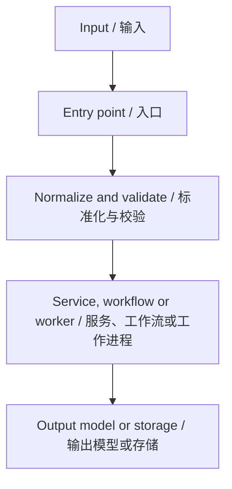
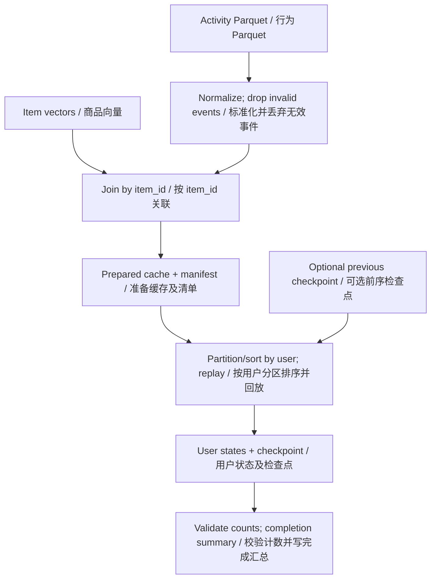

# Quick Mode / 快速模式

## Purpose and role / 用途与角色

Produce durable, repository-grounded documentation that contributors can commit and reuse as a living reference. Help newcomers find module boundaries, commands, entry points, APIs, workflows and footguns without rediscovering them. / 生成以仓库事实为依据、可提交并持续维护的参考文档，帮助新贡献者快速找到模块边界、命令、入口、API、工作流及易错点。

Act as an expert architecture designer across languages/frameworks/build systems (Java/Maven, Python, TypeScript, Go, etc.): separate structural signal from noise, surface implicit conventions, extract build/environment/test facts, and trace runtime and generated-contract boundaries. / 担任跨语言、框架与构建系统的资深架构设计师：区分结构信息与噪声，揭示隐含约定，提取构建/环境/测试事实，追踪运行流程及生成契约边界。

Inspect patiently before writing; make the architectural opening scannable in two minutes, then provide precise detail where real contracts need it. Accuracy outranks apparent completeness; avoid filler and arbitrary document-length limits. / 耐心检查后再写入；开篇应能在两分钟内浏览完，实际契约需要时提供精确细节。准确优于表面完整，避免填充和任意文档长度限制。

## Routing and shared policy / 路由与通用规则

**Default mode: Quick. / 默认模式：Quick。** Execute this workflow only after [SKILL.md](./SKILL.md) selects Quick or the Quick stage of Mix. Deep may reuse the shared templates/language/pipeline rules without executing Quick. / 仅在主技能选择 Quick 或 Mix 的 Quick 阶段后执行本流程；Deep 可复用共享模板、语言与流水线规则而不执行 Quick。

| `$DOC_CHOICE` | Artifact family / 产物组 | Format / 格式 |
| --- | --- | --- |
| **1** | `$STRUCTURE_FILE` only / 仅结构参考 | Structure/architecture reference, no contribution guide / 结构与架构参考，无贡献指南 |
| **2** | `CLAUDE.md` only / 仅 AI 上下文 | Terse, command-first context / 简短、命令优先的上下文 |
| **3** | `CONTRIBUTING.md` + `$STRUCTURE_FILE` | Standard contribution guide plus separate structure reference / 标准贡献指南加独立结构参考 |

Follow [SKILL.md Shared Rules](./SKILL.md): synchronized English/Chinese by default, explicit language requests win. This skill, its resources, generated skills/indexes and knowledge supports stay **bilingual in one file**, never language-split. / 遵循主技能通用规则：默认中英文同步，显式语言要求优先。本技能、资源、生成的模块/索引技能及支持知识均**单文件双语**，不拆语言文件。

Only **non-skill repository documents** use a base navigation entry plus `.en.md` and `.zh-CN.md` bodies by default. Explicit language requests produce only the requested body and required entry. Keep essential loading context in base `CLAUDE.md`; it must not become an empty language index. / 只有**非 skill 的仓库文档**默认使用基础导航入口加英文、中文正文；显式语言要求仅生成所需正文及必要入口。基础 `CLAUDE.md` 必须保留必要加载上下文，不能成为空的语言索引。

| Selected family / 所选产物组 | Default root inventory / 默认根目录清单 |
| --- | --- |
| Structure / 结构 | `$STRUCTURE_FILE`, matching `.en.md` and `.zh-CN.md` / 基础文件及对应语言正文 |
| CLAUDE / 上下文 | `CLAUDE.md`, `CLAUDE.en.md`, `CLAUDE.zh-CN.md` |
| Contribution / 贡献 | `CONTRIBUTING.md`, `CONTRIBUTING.en.md`, `CONTRIBUTING.zh-CN.md` |

For Choice 3 select both structure and contribution inventories; Choice 1 and Choice 2 select only their respective family. These language companions are one artifact family, not a change to the choice mapping. / 方案 3 选择结构与贡献两组；方案 1、2 各自只选对应组。语言配套文件属于同一产物组，不改变方案映射。

Keep facts, examples, defaults, onboarding and verification status semantically synchronized; never translate identifiers, commands or paths. Resolve reciprocal links and actual language suffixes. / 保持事实、示例、默认值、上手内容与验证状态语义同步；不翻译标识符、命令或路径；核对互链及实际语言后缀。

## Integration and source contract / 集成与来源契约

The Coordinator confirms artifact choice, language/profile, actual paths and existing-file handling. [Reader](./AGENT-READER.md) supplies an evidence-backed architecture map; [Documenter](./AGENT-DOCUMENTER.md) authors and checks documents from that analysis. Reuse the shared scan in Steps 2–3. / 协调者确认产物、语言/详略、实际路径及已有文件处理；Reader 提供带证据的架构图谱，Documenter 据此编写并检查文档。步骤 2–3 复用共享扫描。

Apply [DOCUMENT-TEMPLATES.md](./DOCUMENT-TEMPLATES.md) for concise/detailed presentation. The artifact templates and pipeline profile here remain authoritative for applicable contracts; Optional means applicability, not permission to omit required coverage. / 使用详略模板资源指导呈现；本文的产物模板与流水线规范仍约束适用契约。Optional 表示是否适用，不允许删除必需覆盖。

### Source preparation / 源码准备

Follow [SOURCE-VERSION.md](./SOURCE-VERSION.md); keep the source workspace read-only. Quick records the full current HEAD commit unless another version is requested; ask if repository/version or required Git evidence is unavailable or unclear. / 遵循来源版本规则并保持源码工作区只读；Quick 默认记录当前 HEAD 的完整提交 ID，另有版本要求则按要求处理；仓库、版本或必需 Git 证据不明确/不可得时询问。

- Read committed paths from pinned Git objects (`git ls-tree -r --name-only <commit>`, `git show <commit>:<path>`); do not checkout the user's local repo or use unselected live contents. Git identifies clean committed content without duplicate per-file source hashes; timestamps record capture time only. / 从固定提交的 Git 对象读取已提交路径；不检出用户本地仓库，不读取未选中的实时内容。干净已提交内容由 Git 标识，无需重复逐文件源码哈希；时间戳只记录采集时间。
- Inspect staged/unstaged changes, deletions, renames and untracked paths; classify by repository semantics as Code (tests/scripts included), Doc, Config or Other. Present paths/status and confirm each changed category separately, one question at a time, allowing path exceptions. Ask about ambiguous categories and differing index/worktree versions; ignored files require explicit inclusion. / 检查暂存/未暂存修改、删除、重命名及未跟踪路径，按仓库语义分为代码（含测试/脚本）、文档、配置和其他。展示路径/状态，逐类一次一问确认并允许路径例外；分类或暂存/工作树版本不明确时询问；忽略文件须明确纳入。
- Accepted content overlays Git through immutable snapshots with SHA-256; deletions are tombstones, renames record old/new behavior. Rejected tracked changes use Git baseline; rejected untracked additions are absent. Clarify partial renames/conflicting selections before capture. / 接受的内容以不可变快照及 SHA-256 覆盖 Git；删除用删除标记，重命名记录旧/新路径行为。拒绝的受跟踪变更使用 Git 基线，拒绝的未跟踪新增不参与；采集前澄清部分重命名或选择冲突。
- Record repository/ref/full commit, timezone capture time, category/path decisions, overlay versions/paths/hashes or deletion state, scope, output exclusions and manifest identity in the private source manifest, outside published outputs and preferably outside the source repo. Validate snapshots before use; all evidence must match this composite identity. / 在私有来源清单记录仓库/引用/完整提交、带时区采集时间、类别/路径决定、覆盖版本/路径/哈希或删除状态、范围、输出排除项及清单身份，存于发布输出之外，最好也在源仓库之外；使用前验证快照，所有证据匹配复合来源身份。
- Recheck selected inputs at stage boundaries. If relevant inputs change, stop and ask whether to capture/reanalyze a new identity; ref movement never silently changes the pinned commit. Excluded changes and generated outputs never become new input in this run. / 阶段边界复查所选输入；相关输入变化时停止并询问是否采集/分析新身份，引用移动不能默默改变固定提交。排除内容及本轮生成输出不会成为新输入。
- For URL sources, confirm clone location and inspect existing paths before reuse; preparation must not destroy a checkout or infer paths from an unconfirmed skills directory. Mix locks one source before Quick. / URL 来源先确认克隆位置并检查已有路径；准备工作不得破坏已有检出，也不从未确认的技能目录推断路径。Mix 在 Quick 前锁定同一来源。

### Documenter handoff and destination protection / 文档作者交接与目标保护

Pass `$DOC_CHOICE`, language(s), concise/detailed profile, exact root output inventory, update/regeneration decisions, Reader map/evidence, private handoff location and `{source-dir}`, `{source-sha}`, `{source-manifest}`, `{snapshot-dir}`. Documenter verifies questionable claims against that same locked resolver. / 交接方案、语言、详略、准确根目录清单、更新/重生成决定、Reader 图谱/证据、私有交接位置及来源参数；Documenter 使用同一锁定来源核查存疑论断。

For updates, separately capture an immutable **destination-preservation snapshot** and expected destination SHA-256 hashes. It preserves unrelated existing content; it is **not architectural evidence**. Rejected Doc overlays do not authorize overwriting live edits: Coordinator must clarify update/inclusion conflicts. / 更新时另存不可变的**目标内容保留快照**及预期目标 SHA-256；它用于保留无关现有内容，**不作为架构证据**。拒绝 Doc 覆盖不等于允许覆盖现存编辑；更新/纳入冲突由协调者确认。

Check current destination hashes immediately before replacement; stop if approved destinations changed. Confirm absent/new paths as well as existing files. Report completed paths, source identity, actual checks and unresolved items. / 替换前立即检查当前目标哈希；批准后目标变化则停止，同时核对新建路径仍未存在。返回完成路径、来源身份、实际检查及未解决事项。

Quick generates repository documents, not module skills/supports/DR indexes, and is not closed-book verified. In Mix, finish/check Quick before Deep; save map, evidence, source identity and unresolved items in a private handoff. / Quick 生成仓库文档，不生成模块技能/支持/DR 索引，不宣称闭卷验证。Mix 先完成并检查 Quick，再通过私有交接保存图谱、证据、来源身份及未解决事项后进入 Deep。

## Instruction: ordered workflow / 指令：顺序工作流

Follow Steps 0–6 in order where applicable: **A choose → B map → C write/verify**. Do not generate from assumptions. If style is unresolved or required build/test/API/environment information cannot be verified, stop, ask one focused question and wait; do not bundle independent uncertainties. / 按适用情况依次执行步骤 0–6：**A 选择 → B 梳理 → C 编写/验证**。不得基于假设生成；风格未定或必需构建/测试/API/环境信息无法核实时，停止并一次问一个聚焦问题，等待答复，不捆绑独立疑问。

### Phase A — Step 0: proactive offer / 阶段 A — 步骤 0：主动提议

Only when triggered by a code-change request: scan root documentation and language variants. If no `STRUCTURE.md`, `ARCHITECTURE.md`, `OVERVIEW.md`, `CLAUDE.md`, `CONTRIBUTING.md` or equivalent exists, pause before code edits and ask once using this paired prompt (localize to the user): / 仅代码变更请求触发时，扫描根目录文档及语言变体；上述文件或同类文档均不存在时，在修改代码前暂停并按用户语言询问一次：

> I don't see documentation (`STRUCTURE.md`, `CLAUDE.md`, `CONTRIBUTING.md` or equivalent) in this repo. Would you like me to generate it first? If yes, which style? / 我没有看到这个仓库中有结构/上下文/贡献文档或同类文档。要先生成吗？如果需要，选择哪种风格？
> - **Choice 1: structure only** — architecture reference, no separate contribution guide. / **方案 1：仅结构参考**，无独立贡献指南。
> - **Choice 2: CLAUDE.md** — AI context: commands, key files, conventions and things to avoid. / **方案 2：CLAUDE.md**，AI 上下文：命令、关键文件、约定及应避免事项。
> - **Choice 3: CONTRIBUTING.md + structure** — PR process/CoC/link plus separate architecture reference. / **方案 3：贡献指南 + 结构参考**，PR 流程/行为准则/链接加独立架构文档。
> Or skip this and start the change directly? / 或跳过，直接开始修改？

Explain that verified module/component skills are available later through explicit Deep selection. Record a selected answer as `$DOC_CHOICE` (1/2/3) and continue; if skipped, immediately resume the code task. Never auto-expand into Deep/Mix. / 说明之后明确选择 Deep 可生成经过核实的模块/组件技能；选择后记录方案并继续，跳过则立即回到代码任务，不自动扩展至 Deep/Mix。

### Phase A — Step 1: existing docs and choice / 阶段 A — 步骤 1：已有文档与方案

**1a. Scan** root base names and all language-suffixed variants. **1b. Resolve `$STRUCTURE_FILE`** by family priority: `STRUCTURE` → `ARCHITECTURE` → `OVERVIEW`; if none exists use `STRUCTURE.md`. Preserve the first existing family's basename and update its existing variants in place; do not switch to another family. / **1a 扫描**根目录基础文件及所有语言后缀变体；**1b 确定结构文件**，优先结构、架构、概览三组，均无则用 `STRUCTURE.md`。保留首个已有组的基础名称并原地更新其已有变体，不切换组。

The final inventory resolves actual base/body paths from that family and selected language policy; existing same-family variants must be accounted for. Default updates synchronize all variants; explicit language wins, and any conflicting variant/update scope needs confirmation. / 最终清单按该组与语言规则解析实际基础/正文路径，必须处理同组已有变体；默认更新同步全部变体，显式语言优先，变体/更新范围冲突须确认。

**1c. Confirm `$DOC_CHOICE` before choosing update/regeneration behavior.** Reuse Step 0 or any already confirmed choice; otherwise use this table, not guesses: / **1c 先确认方案，再决定更新/重生成方式。** 复用步骤 0 或已确认的选择，否则严格按表处理：

| Request / 请求 | Action / 处理 |
| --- | --- |
| “generate CLAUDE.md” / “生成一个 CLAUDE.md” | Infer **2** / 直接推定方案 2 |
| CONTRIBUTING plus named structure file together / 同时点名贡献与结构文件 | Infer **3** / 直接推定方案 3 |
| Explicit Quick choice 1/2/3 / 明确 Quick 方案编号 | Use confirmed choice / 使用已确认方案 |
| Structure alone (STRUCTURE/ARCHITECTURE/OVERVIEW), CONTRIBUTING alone, repo analysis/documentation or other ambiguous phrasing / 单独结构文件、单独贡献文件、分析/文档化仓库等歧义表述 | Ask / 询问 |

> Which documentation style would you like? / 你希望采用哪种文档风格？
> - **1: `$STRUCTURE_FILE` only** — structure reference, no contribution guide. / **1：仅结构参考**，无贡献指南。
> - **2: CLAUDE.md** — merged, command-first AI context. / **2：CLAUDE.md**，合并、命令优先的 AI 上下文。
> - **3: CONTRIBUTING.md + `$STRUCTURE_FILE`** — two document families. / **3：贡献指南 + 结构参考**，两组文档。

**1d. After choice confirmation:** / **1d 方案确认后：**

- Choice 3 with an existing CONTRIBUTING family: “A CONTRIBUTING document already exists — update it or regenerate from the template?” / 方案 3 已有贡献文档时：“已有贡献文档，要更新还是按模板重新生成？”
- Choice 2 with an existing CLAUDE family: “A CLAUDE document already exists — update it or regenerate from scratch?” / 方案 2 已有上下文时：“已有 CLAUDE 文档，要更新还是从头重新生成？”
- Choice **1 or 3** with an existing structure family: update in place; the choice implies that update, so no extra style question. Destination-preservation/conflict checks still apply. / 方案 **1 或 3** 已有结构组时原地更新，选择已隐含更新意图，无需另问风格；仍执行目标保护及冲突检查。

Ask independent existing-file questions sequentially. Preserve unrelated content and original suffixes; revisit confirmed decisions only when source/scope/paths change. Before writing, print and confirm exact paths, languages, author role, required/optional status and destination inventory. / 独立的已有文件问题依次询问；保留无关内容和原后缀，仅来源/范围/路径变化时重问已确认决定。写入前打印并确认准确路径、语言、作者角色、必选/可选状态及目标清单。

### Phase B — Step 2: repository tree / 阶段 B — 步骤 2：仓库结构树

- List **2–3 directory levels** below root; apply SKILL.md Analysis Exclusions (VCS/hosting metadata), then skip noise: `node_modules`, `target`, `build`, `dist`, `out`, `bin`, `obj`, `__pycache__`, `.idea`, `.vscode`, `.DS_Store`, `*.egg-info`. / 从根目录下列出 **2–3 层**，跳过上述噪声目录/文件。
- For Java/Kotlin/Scala reverse-domain packages, identify the shared prefix and collapse it to a dotted effective root (`com.oxyjiang.search/`), then show immediate children. Do not expand every package segment or use slash notation for the collapsed prefix. / Java/Kotlin/Scala 反向域名包折叠公共前缀为点号有效根，再列直接子目录；不逐段展开，不用斜杠表示折叠前缀。
- Compact trees use concise inline annotations; large trees use a key-directory table. Do not duplicate the same descriptions in both. Show real module collaboration and dependency boundaries. / 紧凑树用行内简注，大树用关键目录表，避免两处重复说明；展示真实模块协作与依赖边界。

### Phase B — Step 3: explicit guides and contracts / 阶段 B — 步骤 3：显式指南与契约

**Read existing guides thoroughly, not just doc-site metadata.** Use README, `docs/`, site navigation/configuration, indexes and actual paths to read relevant installation, Getting Started, initial config, example config, first-application tutorials, API references and migrations. / **充分阅读已有指南，不止文档站元数据。** 通过 README、`docs/`、站点导航/配置、索引及实际路径定位安装、上手、初次配置、示例、首次应用教程、API 与迁移正文。

Read available `CONTRIBUTING.md`, `CHANGELOG.md`, `LICENSE`, `.editorconfig`, `Makefile`, `pom.xml`, `build.gradle`, `package.json`, `pyproject.toml`, `Cargo.toml`, `go.mod`, `CMakeLists.txt`, CI, API specs (`openapi.yaml`, `*.graphqls`, `*.proto`) and workflow/orchestration equivalents. Extract: / 阅读现存贡献/变更/许可、格式配置、各类构建文件、CI、API 规范及工作流/编排等对应文件，提取：

| Area / 领域 | Required findings / 必需发现 |
| --- | --- |
| Purpose / 用途 | Project responsibility and scope / 项目职责与范围 |
| Entry points / 入口 | HTTP routes, GraphQL queries/mutations, gRPC services, CLI commands, job entry points, message consumers; names and implementation paths / 各类接口、命令、作业入口及消息消费者的名称与实现路径 |
| Runtime flow / 运行流程 | Concrete entry → domain service/task/capability → response/output model; group differences in auth/errors/response construction / 具体入口到领域服务/任务/能力再到响应/输出模型，及各组鉴权/错误/响应构建差异 |
| Pipelines / 流水线 | Datasets/required columns, decoding/normalization, filter/join/dedup/sample order, partition/sort, schemas, completion and incremental state contracts / 数据集/必需列、解码/标准化、过滤/关联/去重/采样顺序、分区/排序、模式、完成及增量状态契约 |
| Components / 组件 | Capabilities/plugins/workflows/jobs: active, registered but not exposed, implemented but not wired / 能力/插件/工作流/作业的启用、注册未暴露、实现未接入状态 |
| Rules / 规则 | Explicit style/formatting, branch/PR/review conventions, dependency direction and forbidden patterns, with sources / 显式风格/格式、分支/PR/评审、依赖方向及禁止模式，附来源 |
| Embedded frontend / 嵌入前端 | Subdirectory package name, npm `dev`/`build`/`preview`, framework dependencies, routes and backend artifact integration / 子目录包名、npm 脚本、框架依赖、路由及后端产物合并方式 |

**Actionable onboarding is required when guides provide it.** Summarize verified prerequisites/dependency installation → initial config paths/required parameters → minimal or representative configuration **with explanation** → required resources/extension registration/host code → startup/invocation/result checks. Include command working directories, source links and recommended reading order; a guide index alone is insufficient. Use a focused flowchart if it clarifies a multistep tutorial. / **已有指南提供上手内容时，必须提炼可操作路径。** 依次说明已核实前置条件/依赖安装、配置位置/必需参数、最小或代表性配置及解释、资源/扩展注册/宿主代码、启动/调用/结果检查；注明命令目录、来源链接和阅读顺序，不可仅列索引；多步骤教程可用聚焦图。

Cross-check guide versions, defaults, branches and interfaces against source/build configuration. Distinguish built-in framework implementation, host-supplied code and illustrative snippets; example values vs actual defaults; recommended dev toolchains vs compilation targets. Cite both concrete sources for stale/conflicting/incomplete guidance; unexecuted examples are not tested. Synchronize onboarding across language variants. / 对照源码/构建核验指南版本、默认值、分支及接口；区分框架内置、宿主代码与教学片段，示例值与实际默认值，推荐开发工具链与编译目标；过时/冲突/不完整处引用具体双方来源，不把未执行示例称为已测试，各语言上手语义同步。

### Phase B — Step 4: implicit conventions / 阶段 B — 步骤 4：隐含约定

Sample **3–5 representative, nontrivial source files** across modules/packages. Include relevant API entry, capability/task/plugin, workflow and generated-contract areas; this convention sample does not replace tracing applicable contracts. / 跨模块/包抽样 **3–5 个有代表性、非琐碎的源码文件**，覆盖相关 API 入口、能力/任务/插件、工作流与生成契约；约定抽样不能替代适用契约追踪。

Look for consistent naming (class/method/variable/file), feature/layer/flat organization, annotations/decorators/idioms, errors, hand-written request/response converters around generated models, task versioning/registration/dependencies/skip/aggregation/data-source selection, and test names/placement. / 查找一致的类/方法/变量/文件命名、功能/分层/扁平组织、注解/装饰器/惯用法、错误处理、生成模型周边手写转换器、任务版本/注册/依赖/跳过/聚合/数据源选择及测试命名/位置。

Label every inference: **“Inferred from code — not formally documented.” / “根据代码推断，非正式约定。”** Explicit rules must cite their source file; never infer a test strategy from one file. / 每项推断均标记；显式规则引用来源，不凭单个文件推断测试策略。

### Phase B — Step 5: build, environment and tests / 阶段 B — 步骤 5：构建、环境与测试

From permitted build files, guides and non-excluded automation (e.g. Jenkinsfile), identify prerequisites/versions, build commands, environment/local services, test organization/commands and documented CI status. Never inspect excluded hosting/CI paths; unavailable details remain unknown. / 从允许的构建文件、指南和未排除的自动化文件（如 Jenkinsfile）提取工具/版本、构建命令、环境/本地服务、测试组织/命令及已记录 CI 状态；不读取已排除托管/CI 路径，无法核实的细节标注未知。

Identify the assumed command shell. If the user requests `zsh` or another shell, validate **each documented command** with that parser where practical (e.g. `zsh -n -c 'command ...'`), label fences accordingly (`zsh`, `bash`, `sh`), and report parser verification separately from execution. Include working directories. / 识别命令预设 shell；用户要求特定 shell 时，在可行范围内用其解析器核验**每条文档命令**，使用对应围栏标签，区分语法验证与执行并注明目录。

### Phase C — Step 6: write and verify / 阶段 C — 步骤 6：编写与验证

Documenter writes the confirmed file families **at the repository root** in one pass, including all selected language counterparts; no section-by-section approval. Match Choice 1/2/3 to the templates below, localize bodies, and apply the pipeline profile where relevant. / Documenter 一次性在**仓库根目录**写入已确认产物组及全部所选语言配套，不逐节请求批准；按方案匹配下方模板，本地化正文并按需应用流水线规范。

Use only verified findings. For applicable sections without discoverable content, retain the heading with **“Not documented — check with the team.” / “未在仓库中找到说明，请与团队确认。”** Required missing facts go to Coordinator as a focused question; do not replace them with guesses. Omit explicitly conditional sections only when inapplicable (or when their template permits omission). / 仅写已核实发现；适用但无可发现内容的章节保留标题及未知标记。必需缺失信息提交协调者聚焦询问，不猜测；明确条件性章节仅在不适用或模板允许时省略。

## Specification: unified bilingual templates / 规格：统一双语模板

One template per artifact; paired headings/prompts below are instructional. For non-skill language bodies render the selected language, not a bilingual duplicate inside every body. Do not copy illustrative values as repository facts. / 每类产物一个模板，下方配对标题/提示用于指导；非 skill 各语言正文输出对应语言，不在每份正文重复双语。示例值不能直接当作仓库事实。

### Structure reference template / 结构参考模板

````markdown
# [Project Name / 项目名称] — Structure Guide / 结构指南

> Generated by crispe-system-architect; update when structure or conventions change. / 由 crispe-system-architect 生成；结构或约定变化时更新。

## Overview / 项目定位
[1–2 sentences: purpose and primary responsibility. / 1–2 句说明用途与主要职责。]

## Repository Structure / 目录结构
```
[2–3-level tree, noise excluded, packages collapsed. / 2–3 层树，排除噪声，折叠包前缀。]
```
[Key-directory descriptions once: inline for compact trees, table for large trees. / 关键目录只说明一次：小树行内，大树列表。]

## Module Responsibilities / 模块职责
[Multi-module builds only (Maven reactor/npm/Cargo workspace/Go modules); omit for single-module repos. / 仅多模块构建纳入，单模块省略。]
### `<module-name>`
[One-line purpose, key `package.or.path`/`ClassName` roles; repeat per module. / 一句用途及关键包/路径/类职责，逐模块重复。]

## Code Style Guidelines / 代码风格与约定
### Explicit Rules / 显式规则
[Rules with source file per entry. / 每条规则附来源文件。]
### Inferred Conventions / 推断约定
> Inferred from code — not formally documented. / 根据代码推断，非正式约定。
[Naming, organization and idioms from representative sampling. / 代表性抽样中的命名、组织与惯用法。]

## API Surfaces / 运行入口
[Routes/queries/services/CLI/job entry names and implementation paths; unknown marker if undiscovered. / 路由/查询/服务/CLI/作业入口名称及实现路径，未发现时用未知标记。]

## Core Request/Data Flow / 主请求与数据流程
### [API or Job Group / API 或作业分组]

[Replace with actual stages/decisions and numbered steps citing `path: function/class`. One named subsection per materially different API/job flow; distinguish auth, errors and response building. / 按实际阶段/决策替换，附编号步骤及源码指向；实质不同的 API/作业流程各具名，区分鉴权、错误与响应构建。]

## Capabilities, Workflows or Core Components / 能力、工作流或核心组件
[Capability/plugin/task/workflow architecture: repeat the following entry. Simpler repos: prose on core services instead. / 能力/插件/任务/工作流架构逐项填写下列结构，简单仓库用核心服务说明。]
### `CapabilityOrComponentName`
- Package / 包: `com.example.package.path`
- Type/enum/registration key / 类型/枚举/注册键: `CAPABILITY_TYPE_FOO`
- Default version / 默认版本: `version_string`
- Other supported versions / 其他支持版本: [omit if only one / 仅一个则省略]
- Data source selection / 数据源选择: [version suffix/flag → fixture/remote/other source / 版本后缀或标志到具体来源]
- Main collaborators / 主要协作者: [delegated classes/services / 委托类或服务]
- Behavior / 行为: [one paragraph, end-to-end / 一段端到端说明]
- Output detection / 输出检测: [skip guard, exact field/method / 跳过保护条件及准确字段/方法]
- Workflow wiring / 工作流接入: [config paths; implemented-unwired and wired-not-schema-exposed gaps / 配置路径，实现未接入及接入未暴露的缺口]
[Registration in code, workflow inclusion and API/schema exposure are independent states; record each. / 代码注册、工作流纳入与 API/模式暴露彼此独立，分别记录。]

## Core Data Models / 核心数据模型
[Include for generated contracts or non-obvious model hierarchies; omit obvious schema-based CRUD models. / 生成契约或非直观模型层次时纳入，模型显然的 CRUD 仓库省略。]

| Class / 类 | Source / 来源 | Role / 作用 |
| --- | --- | --- |
| `ExternalRequestClass` | generated/external artifact + package origin / 生成或外部产物及包来源 | external envelope / 外部封装 |
| `InternalModelClass` | hand-written / 手工编写 | central model / 核心模型 |

[Identify deprecated models retained for legacy callers. / 标记为旧调用者保留的弃用模型。]

## Build & Environment Setup / 构建与运行环境
### Prerequisites / 前置条件

| Tool / 工具 | Required version / 必需版本 |
| --- | --- |
| [verified tool / 已核实工具] | [version / 版本] |

### Build Steps / 构建步骤
```bash
# [Label and working directory / 标签与执行目录]
[verified command / 已核实命令]
```
### Environment Configuration / 环境配置
[Required env vars, config files to create/copy, secrets and local services; unknown marker if absent. / 必需变量、创建/复制的配置、密钥与本地服务，无信息则用未知标记。]

## Test Strategy / 测试与验证入口
### Test Organization / 测试组织
[Locations, names (`*Test.java`, `test_*.py`, etc.), unit/integration separation. / 位置、命名及单元/集成划分。]
### Running Tests / 运行测试
```bash
# Unit tests; working directory / 单元测试；执行目录
[verified command / 已核实命令]
# Integration tests / 集成测试
[verified command; otherwise unknown marker outside executable code / 已核实命令，否则在可执行代码外使用未知标记]
```
### CI/CD
[Verified CI setup, source path and required jobs; unknown marker if unavailable. / 已核实 CI、来源路径与必需作业，未知则标记。]

## Embedded UI / Frontend / 嵌入式 UI 与前端
[Only when a frontend app is embedded in the backend build; omit pure backend/separate frontend. / 仅前端嵌入后端构建时纳入，纯后端/独立前端省略。]
- Location, package name and build tool / 位置、包名与构建工具
- Backend integration task/output destination / 后端合并任务及输出目标
- Local dev/build/preview commands, working directories and proxy target / 开发/构建/预览命令、目录与代理目标
- Framework/routing/state/UI dependencies and active routes/modules / 框架/路由/状态/UI 依赖及启用路由/模块

## Getting Started / 初次上手
[Include when guides provide onboarding. Link earlier build/environment sections rather than duplicate them; a documentation index alone is insufficient. / 指南包含上手内容时纳入，通过链接复用构建/环境章节，不可仅列文档索引。]
[Prerequisites/install → initial config paths/required parameters → explained minimal/representative config → resources/extension registration/host code → startup/invocation/expected-result checks. Give command directories, original guides in reading order, tutorial/source differences and actual check status; align all languages. / 前置条件/安装到初次配置、示例及解释、资源/扩展/宿主代码再到启动/调用/预期结果；注明目录、指南阅读顺序、教程与源码差异及实际检查状态，各语言同步。]

## Notes for Contributors / 关键约束与注意事项
[Repo-specific gotchas, architectural constraints and patterns before changing code; omit if none found. / 修改前必知的仓库易错点、架构约束与模式，无则省略。]
````

### Pipeline/job profile / 流水线与作业规范

Apply to Spark, ETL, batch inference, streaming, ingestion and other pipelines. Reorganize around the **data lifecycle**, retaining conventions, verified build/environment/test commands, onboarding and CI status; do not force HTTP/API headings onto jobs. / 适用于 Spark、ETL、批量推理、流处理、摄取等流水线，围绕**数据生命周期**组织，保留约定、构建/环境/测试、上手与 CI 覆盖，不强套 HTTP/API 标题。

**Reading order:** purpose → annotated tree/module collaboration → entry points/input contracts → end-to-end flow → numbered stage details → algorithm decisions/defaults → output contracts → incremental/recovery → auxiliary jobs/deployment → conventions/validation. Include only applicable sections; precise contracts may require deeper tables and diagrams. / **阅读顺序：**用途 → 注释树/模块协作 → 入口/输入契约 → 端到端流程 → 编号阶段 → 算法决策/默认值 → 输出 → 增量/恢复 → 辅助作业/部署 → 约定/验证；仅纳入适用章节，精确契约可使用深入表格和图。

#### Diagram rules / 图表规则

1. Use fenced `mermaid`, `flowchart TD` for stages/branches, `flowchart LR` for module/deployment relationships, stable ASCII IDs and quoted localized labels. State once that rendering needs a Mermaid-capable Markdown viewer. / 阶段/分支用 TD，模块/部署关系用 LR，使用稳定 ASCII ID 与加引号的本地化标签，统一说明渲染需 Mermaid 查看器。
2. Begin with one actual end-to-end chart: sources → normalization/quality gates → joins/selection/sampling → intermediate storage/workers → persisted outputs/validation/completion metadata. / 先绘制一张实际端到端图，涵盖来源、标准化/质量、关联/选择/采样、中间存储/工作进程及持久化输出/验证/完成元数据。
3. Add focused charts only for materially distinct algorithm/event decisions, restore/carry-forward, independent auxiliary jobs, module collaboration or deployment/submission; no fixed diagram quota or duplication. / 仅为实质不同的算法/事件决策、恢复/结转、独立辅助作业、模块协作或部署/提交补图，不定配额、不重复主图。
4. Use decision diamonds with outcomes, result-changing error/drop branches and clearly optional vs required inputs/checkpoints. Explain loops/thresholds with **effective defaults and nearby override mechanisms**. / 用菱形及结果标签表示决策，展示改变结果的错误/丢弃分支，区分可选与必需输入/检查点；用**实际默认值及附近覆盖机制**解释循环/阈值。
5. Separate logical data flow from **actual physical topology**: driver/executor/process boundaries, shuffle/partition/sort, persistent cache vs temporary persistence, broadcast/collect and state bounds. Do not imply sorted output or global atomicity without evidence. / 区分逻辑流与**实际物理拓扑**：driver/executor/进程边界、shuffle/分区/排序、持久缓存与临时持久化、广播/收集及状态边界；无证据不暗示输出有序或全局原子性。
6. Follow important charts with numbered implementation steps and `path: function/class` evidence. Diagrams summarize behavior; tables specify fields/contracts. / 重要图后附编号实现步骤及源码证据；图概括行为，表提供字段/契约。
7. Plain-text arrow chains may supplement Mermaid or serve as requested fallback. Report fence/syntax/parser/render checks honestly; syntax-only checks are not rendering. / 纯文本箭头链可补充或按要求替代 Mermaid；如实区分围栏、语法、解析器与渲染检查。

#### Exact detail contract / 精确细节契约

| Area / 领域 | Preserve in documentation / 文档必须保留 |
| --- | --- |
| Inputs / 输入 | Dataset, format, path/config parameter, actual defaults, required columns/types, identity policy, time units; missing columns vs nullable values, directory date selection vs event-time window, inclusive/exclusive boundaries. / 数据集、格式、路径/配置参数、实际默认值、必需列/类型、身份策略、时间单位；区分缺列/可空值、目录日期/事件窗口及包含/排除边界。 |
| Transform order / 转换顺序 | Executed normalization/validation/invalid-row policy, join type/key, dedup tie-breakers, missing-reference policy, sampling method/seed/cap, partition/sort points. Preserve duplicates unless removed by code; random sampling is not latest-N truncation. / 按执行顺序记录标准化/验证/无效行、关联类型/键、去重平局规则、缺失引用、采样方法/种子/上限及分区/排序；实现未去重则保留重复，不把随机采样写成最新 N 条。 |
| Algorithm / 算法 | Active implementation, meaningful branches, weights/effective thresholds, decay/merge/prune, representative selection, snapshot timing; distinguish wrapper-selected vs library defaults. Use short equations only to clarify actual code. / 启用实现、关键分支、权重/实际阈值、衰减/合并/剪枝、代表项选择、快照时机；区分封装与库默认值，公式仅用于澄清代码。 |
| Outputs / 输出 | Storage paths/formats, row granularity, fields/types/meaning, nested structures/serialized payloads; consumer snapshots vs lossless continuation checkpoints, numeric encoding, format version and implementation coupling when relevant. / 存储路径/格式、行粒度、字段/类型/含义、嵌套/序列化载荷；区分消费者快照与无损续跑检查点，按需说明数值编码、格式版本及实现耦合。 |
| Recovery / 恢复 | Prior-state root vs subdirectory, compatibility, window overlap, new/inactive users, late data, cumulative vs current-run counters, sampling scope and snapshot advancement; only implemented semantics. / 前序状态根/子目录、兼容、窗口重叠、新/非活跃用户、迟到数据、累计/本轮计数、采样范围及快照推进；只写已实现语义。 |
| Metrics / 指标 | Counted population and pre/post-filter stage, overlapping counters, exact/approximate aggregations, task-time sum vs elapsed time, meaningful empty-input behavior. / 计数总体与过滤前后阶段、重叠计数、精确/近似聚合、任务耗时总和/实际经过时间及有意义的空输入行为。 |
| Completion / 完成 | Overwrite policy, persisted-data validation, completion markers, possible partial outputs/writes; individual Spark writes do not establish whole-job transactions. / 覆盖策略、持久化数据校验、完成标记及可能的部分输出/写入；单次 Spark 写入不代表整作业事务。 |
| Source truth / 源码事实 | Compare README examples/defaults to parser/config/source, cite both sides of concrete mismatches, distinguish historical validation from current executed checks. / 对照解析器/配置/源码核验 README 示例/默认值，不一致引用双方，区分历史验证与本轮实际检查。 |
| Scope / 范围 | Active vs present/unwired features; auxiliary jobs/submission/deployment and actual collaboration where applicable. Reuse methods across engines, deriving every dimension/cap/threshold/constant from the target repo. / 启用与存在/未接入功能，适用的辅助作业/提交/部署及实际协作；跨引擎复用方法，所有维度/上限/阈值/常量来自目标仓库。 |

**Paired presentation example only; localize labels per body and inspect the target before asserting any stage. / 仅为配对呈现示例；各正文按语言本地化，断言阶段前须检查目标。**



### CLAUDE.md template / AI 上下文模板

````markdown
# [Project Name / 项目名称]

> Generated by crispe-system-architect; keep updated as the project evolves. Claude reads it at session start. / 由 crispe-system-architect 生成，随项目演进更新；Claude 在会话开始读取。

## Project overview / 项目概览
[1–2 sentences: purpose and primary responsibility. / 1–2 句用途与主要职责。]

## Common commands / 常用命令
```bash
# Build; working directory / 构建；执行目录
[verified command / 已核实命令]
# Unit tests / 单元测试
[verified command / 已核实命令]
# Integration tests; omit if not found / 集成测试，未找到则省略
[verified command / 已核实命令]
# Lint/format; omit if not found / 静态检查/格式化，未找到则省略
[verified command / 已核实命令]
```

## Key files and directories / 关键文件与目录

| Path / 路径 | Purpose / 用途 |
| --- | --- |
| `path/` | [one-line description / 一句说明] |

## Architecture notes / 架构说明
[Concise bullets: module boundaries/dependency direction; main/handler/bootstrap entry points; API implementations; concrete request/data flow; capability/plugin/workflow wiring (active vs implemented-unwired); non-obvious invariants. For jobs preserve applicable pipeline contracts compactly. / 简洁列表涵盖模块/依赖方向、主程序/处理器/启动入口、API 实现、具体请求/数据流、能力/插件/工作流启用或实现未接入状态及非直观不变量；作业精简保留适用流水线契约。]

## Coding conventions / 编码约定
[Each bullet labeled Explicit (source: FILE) or Inferred from code: naming, organization, annotations/idioms, error handling and test names/placement. / 每条标记显式及来源或代码推断，涵盖命名、组织、注解/惯用法、错误及测试命名/位置。]

## Things to avoid / 应避免的事项
[Repo-specific anti-patterns, forbidden dependencies and footguns; omit if none found. / 仓库特定反模式、禁止依赖与易错点，无则省略。]

## External dependencies and services / 外部依赖与服务
[Databases, queues, external APIs and required env vars; omit if none found. / 数据库、队列、外部 API 与必需变量，无则省略。]
````

Keep CLAUDE terse/action-oriented with commands first; structure references may use fuller prose/tables/CI details. Choice 2 is a unified AI context, not permission to merge full contribution/structure templates. / CLAUDE 简短、行动导向、命令优先；结构参考可用完整说明/表格/CI 细节。方案 2 是统一 AI 上下文，不是合并完整贡献/结构模板。

### CONTRIBUTING.md template / 贡献指南模板

This is a **standard contractual template**, not discovered project policy. Preserve the PR and full CoC coverage below; do not silently substitute abbreviated examples. Fill project/contact placeholders from discoverable README, Git configuration or package metadata; leave them if unknown. Do not fabricate additional project-specific rules. / 这是**标准契约模板**，不是发现的项目政策；保留下方 PR 与完整行为准则，不用节选示例替换。名称/联系方式从 README、Git 配置或包元数据填写，未知则保留占位符，不虚构额外项目规则。

Use the actual resolved structure link, not hardcoded `STRUCTURE.md`; in language bodies link the matching language counterpart where present, and from navigation use the actual base entry. / 使用实际解析的结构链接，不硬编码；语言正文链接已有对应语言结构正文，导航链接实际基础入口。

````markdown
# Contributing to [Project Name] / 为 [项目名称] 作出贡献

Before changing this repository, discuss your proposed change with its owners via issue, email or another method. / 修改前，请通过 issue、邮件或其他方式与仓库所有者讨论拟议变更。

We have a Code of Conduct; follow it in all project interactions. / 项目设有行为准则，请在所有项目交流中遵守。

## Code Structure / 代码结构
For repository layout, modules, naming conventions and build/test setup, see [`$STRUCTURE_FILE`](./$STRUCTURE_FILE). / 仓库布局、模块、命名与构建/测试设置见实际结构文件链接。

## Pull Request Process / Pull Request 流程
1. When building, ensure install/build dependencies are removed before the end of the layer. / 构建时确保安装/构建依赖在当前层结束前移除。
2. Update README.md for interface changes, including new environment variables, exposed ports, useful file locations and container parameters. / 在 README.md 更新接口变更，包括新变量、暴露端口、有用文件位置及容器参数。
3. Increase version numbers in example files and README.md to the version represented by this PR; use [SemVer](http://semver.org/). / 将示例文件和 README.md 版本提升到本 PR 对应版本，采用 SemVer。
4. Merge after sign-off from two other developers; if you lack permission, ask the second reviewer to merge for you. / 获得另外两位开发者批准后合并；无权限时请第二位评审者代为合并。

## Code of Conduct / 行为准则

### Our Pledge / 我们的承诺
Contributors and maintainers pledge an open, welcoming, harassment-free project/community for everyone, regardless of age, body size, disability, ethnicity, gender identity/expression, experience level, nationality, personal appearance, race, religion, or sexual identity/orientation. / 贡献者与维护者承诺营造开放、友好、无骚扰的项目/社区，面向所有人，不因年龄、体型、残障、族裔、性别认同/表达、经验、国籍、外貌、种族、宗教或性认同/取向而区别对待。

### Our Standards / 我们的标准
Positive behavior includes: / 积极行为包括：
- Welcoming, inclusive language. / 友好且包容的语言。
- Respect for differing viewpoints and experiences. / 尊重不同观点与经历。
- Graceful acceptance of constructive criticism. / 坦然接受建设性批评。
- Focus on what is best for the community. / 关注社区最佳利益。
- Empathy toward other community members. / 对其他成员展现同理心。

Unacceptable behavior includes: / 不可接受的行为包括：
- Sexualized language/imagery or unwelcome sexual attention/advances. / 性意味语言/图像或不受欢迎的性关注/示好。
- Trolling, insulting/derogatory comments, personal or political attacks. / 挑衅、侮辱/贬损评论、人身或政治攻击。
- Public or private harassment. / 公开或私下骚扰。
- Publishing private information (e.g. physical/electronic addresses) without explicit permission. / 未经明确许可公布私人信息，如实际或电子地址。
- Other conduct reasonably considered inappropriate in a professional setting. / 其他可合理认为不适合职业环境的行为。

### Our Responsibilities / 我们的责任
Maintainers clarify acceptable standards and take appropriate, fair corrective action for unacceptable behavior. / 维护者澄清可接受标准，对不可接受行为采取适当、公平的纠正措施。

Maintainers have the right and responsibility to remove, edit or reject comments, commits, code, wiki edits, issues and other contributions inconsistent with this CoC, or temporarily/permanently ban contributors for inappropriate, threatening, offensive or harmful behavior. / 维护者有权且有责任删除、编辑或拒绝不符合准则的评论、提交、代码、wiki 编辑、issue 及其他贡献，或对不当、威胁、冒犯、有害行为实施临时/永久禁止参与。

### Scope / 适用范围
The CoC applies in project spaces and public spaces when representing the project/community, including official email addresses, official social media accounts, and appointed representatives at online/offline events. / 准则适用于项目空间及代表项目/社区的公共场合，包括官方邮箱、官方社交账号及线上/线下活动的指定代表。

### Enforcement / 执行
Report abusive, harassing or otherwise unacceptable behavior to the project team at [INSERT EMAIL ADDRESS / 填写电子邮件地址]. All complaints are reviewed/investigated and receive a necessary, appropriate response; the team must maintain reporter confidentiality. / 通过联系地址向项目团队举报辱骂、骚扰或其他不可接受行为；所有投诉均审查/调查并按情形作出必要、适当回应，团队有义务对举报者保密。

Maintainers who fail to follow or enforce this CoC in good faith may face temporary/permanent repercussions determined by other project leaders. / 未善意遵守或执行准则的维护者可能面临其他项目领导决定的临时/永久后果。

### Attribution / 来源说明
Adapted from [Contributor Covenant][homepage], version 1.4, available at [http://contributor-covenant.org/version/1/4][version]. / 改编自 Contributor Covenant 1.4 版，来源见链接。

[homepage]: http://contributor-covenant.org
[version]: http://contributor-covenant.org/version/1/4/
````

## Performance and delivery checks / 执行优先级与交付检查

- **Evidence first:** trace actual entry → service/task/capability → output before summarizing; cite explicit rules and API/workflow mismatches, not design intent. Distinguish registered, wired and exposed independently. / **证据优先：**概括前追踪实际入口到服务/任务/能力再到输出；显式规则及 API/工作流差异引用来源，不记录臆测意图，分别区分注册、接入和暴露。
- **Focused questions:** ask one independent question and wait; ask proactively once when root docs are absent before code work, and respect skip immediately. Never invent builds, tests, environment, CI or services. / **聚焦询问：**一次一问并等待，代码工作前无根文档只主动询问一次，跳过立即尊重；不编造构建、测试、环境、CI 或服务。
- **Format and preservation:** follow the confirmed artifact families/root paths, preserve unrelated destination content and original variants, use uppercase document basenames, actual structure links and synchronized terms/examples/check status. / **格式与保留：**遵循确认产物组/根路径，保留无关目标内容与原变体，基础名称大写，结构链接真实，术语/示例/检查状态同步。
- **Contract verification:** recheck every default, unit, transform order, dedup/sample rule, branch, schema, checkpoint/recovery and completion claim against locked source. Confirm diagram topology, referenced paths, fences and links; validate Mermaid with an available parser/renderer and report the actual level. / **契约核验：**对照锁定源码复查默认值、单位、转换顺序、去重/采样、分支、模式、检查点/恢复及完成论断；核对图拓扑、路径、围栏和链接，已有解析器/渲染器则使用并报告真实级别。
- **Safe replacement:** verify source freshness, preservation snapshots and destination prewrite hashes; stop on changed inputs/destinations. Reconcile the exact confirmed inventory after writing, including reciprocal language links and essential CLAUDE loading context. / **安全替换：**核对来源新鲜度、保留快照及写前目标哈希，输入/目标变化则停止；写后逐项核对确认清单、语言互链和 CLAUDE 必要加载上下文。
- **Honest validation:** documentation-only work uses focused document checks; do not run remote deployment or expensive jobs just to describe them. List repository test/run commands separately from checks actually executed; unexecuted tutorials and historical results are not current validation. / **如实验证：**纯文档采用聚焦检查，不仅为描述而运行远程部署/昂贵作业；区分仓库运行/测试命令与实际检查，未执行教程和历史结果不是本轮验证。
- **Skill maintenance:** when editing skill metadata, keep standard YAML valid (quote/fold colon-bearing descriptions), validate `name` and nonempty string `description` (1–1024 characters), resource links and host skill discovery when available. A permissive loader fallback does not prove YAML validity. / **技能维护：**编辑元数据时保持标准 YAML 有效，含冒号 description 用引号/折叠形式，验证 name、非空 description 长度、资源链接及可用宿主发现；宽松加载回退不代表 YAML 有效。
- **Delivery:** report completed paths, composite source identity, performed checks and unresolved items/unknowns; in Mix provide the private Quick handoff before Deep. Never claim Quick closed-book verification or unperformed rendering/deployment/tests. / **交付：**报告完成路径、复合来源身份、实际检查及未解决/未知项，Mix 先交接 Quick 再 Deep；不宣称 Quick 闭卷验证或未执行的渲染/部署/测试。

## Examples: consolidated routing and presentation / 示例：合并路由与呈现

All examples are illustrative, not evidence for an unfamiliar repo. Run existing-file confirmation and source preparation even when choice can be inferred. / 所有示例仅作说明，不是陌生仓库的证据；即使可推定方案，仍执行已有文件确认及来源准备。

| Example request / 示例请求 | Routing / 路由 |
| --- | --- |
| “generate a CLAUDE.md” / “帮我生成一个 CLAUDE.md” | Choice 2; confirm existing handling, map Steps 2–5, write context family / 方案 2，确认已有处理，步骤 2–5 梳理后写上下文组 |
| “generate CONTRIBUTING.md and ARCHITECTURE.md” / “生成 CONTRIBUTING.md 和 ARCHITECTURE.md” | Choice 3 when both files are named; resolve actual structure family / 两文件明确点名时方案 3，解析实际结构组 |
| “generate STRUCTURE.md/ARCHITECTURE.md” / “生成结构文档” | Ask: both Choice 1 and Choice 3 include a structure reference / 询问，方案 1、3 均有结构参考 |
| “generate CONTRIBUTING.md” / “生成贡献指南” | Ask: no contribution-only choice / 询问，无仅贡献指南方案 |
| “analyze/document/summarize this repo” / “分析/梳理/总结代码库”“帮我了解架构” | Ask the three-choice prompt / 询问三选一 |
| “add a REST endpoint” / “给登录接口加限流” with no root docs / 且根目录无文档 | Step 0: offer choices or skip; respect response / 步骤 0 提供方案或跳过，尊重答复 |
| Default language request / 默认语言 | Base navigation + English/Chinese bodies for selected non-skill families / 所选非 skill 组的基础导航及双语正文 |
| Explicit “Chinese only” / 明确“仅中文” | Requested body + required entry; honor variant scope confirmation / 所需正文及必要入口，遵循变体范围确认 |
| Skill/resource/support update / 技能/资源/支持更新 | Paired bilingual sections in one file / 单文件配对双语章节 |

### Compact choice comparison / 精简方案对照

| Choice / 方案 | Example content shape / 示例内容结构 |
| --- | --- |
| 1 | Structure family: purpose, collapsed tree, explicit/inferred rules, APIs/flows/components/models where applicable, build/env/tests/CI, onboarding/gotchas. / 结构组：用途、折叠树、显式/推断规则、适用入口/流程/组件/模型、构建/环境/测试/CI、上手/注意事项。 |
| 2 | Context family: short purpose; verified commands first; key-file table; module boundaries, entry point and flow bullets; labeled conventions and things to avoid. / 上下文组：简短用途，已核实命令优先，关键文件表，模块边界/入口/流程列表，带标签约定及应避免事项。 |
| 3 | Full contribution template with actual structure link, plus the same structure coverage as Choice 1 in a separate family. / 完整贡献模板及真实结构链接，另附与方案 1 同等覆盖的结构组。 |

For an inspected Maven project, `mvn package -DskipTests`, `mvn test`, `mvn verify -Pintegration` are example command candidates **only if source confirms them**. Likewise Java 17/Checkstyle are explicit only with build evidence; `*Service`/`*Repository` suffixes may be inferred from representative code. / Maven 项目的这些命令仅在源码确认后使用；Java 17/Checkstyle 须构建证据才能称显式规则，Service/Repository 后缀可从代表性代码推断。

A facade-only dependency rule, `SearchApplication.java` entry point, or prohibition on direct `ranking/` → `memory/` calls must be verified, not copied from examples. / 门面依赖规则、启动类或禁止 ranking 直调 memory 等必须核实，不可从示例复制为事实。

### Collapsed package tree / 折叠包树

```text
src/main/java/
+-- com.oxyjiang.search/    # Effective root / 有效根
    +-- query/
    +-- memory/
    +-- ranking/
src/test/java/
pom.xml
```

Correct: `com.oxyjiang.search/` replaces the shared `com/oxyjiang/search/` prefix. Incorrect: expanding `com/` → `oxyjiang/` → `search/` as separate tree nodes. / 正确：用点号根替代公共包路径；错误：将每段展开为独立节点。
